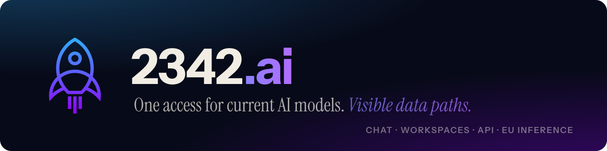

  

**2342.ai** is an AI platform from Germany. One access gives you chat, workspaces and an API for the current models from OpenAI, Anthropic, Google and others, with the data path of every model visible before you use it.

- **One budget instead of many vendor accounts.** Teams share a usage budget without per-seat pricing. API keys, usage and cost stay traceable per person and per key.
- **Choose the data path.** The catalog shows where a model runs. GLM 5.2 is served from a regional European endpoint. For external models, purpose, data path and contract decide what fits.
- **Your coding tools, unchanged.** One API key speaks OpenAI-compatible Chat Completions, the Responses API and the Anthropic Messages API. Claude Code, OpenCode, Codex CLI and your own apps work by pointing their base URL at 2342.ai.
- **Documented, not promised.** DPA, subprocessors and retention rules are public.

## Open source

| Project | What it is |
|---|---|
| [**agentic-rescue**](https://github.com/2342-ai/agentic-rescue) | A NixOS rescue stick with opencode, Claude Code and Codex inside. Your key goes into the image in the browser before it ever boots. [rescue.2342.ai](https://rescue.2342.ai) |

## Links

[2342.ai](https://2342.ai) · [Models](https://2342.ai/en/models) · [API for coding tools](https://2342.ai/en/messages-responses-api-proxy) · [Inference in Europe](https://2342.ai/en/ai-inference-europe) · [DPA](https://2342.ai/en/dpa) · [Subprocessors](https://2342.ai/en/subprocessors) · [anycast.io](https://anycast.io)

---

<b>Auf Deutsch</b>

**2342.ai** ist eine KI-Plattform aus Deutschland. Ein Zugang bringt Chat, Arbeitsbereiche und eine API für aktuelle Modelle von OpenAI, Anthropic, Google und anderen, und zu jedem Modell ist der Datenweg sichtbar, bevor du es nutzt.

- **Ein Budget statt vieler Anbieterkonten.** Teams teilen ein Nutzungsbudget ohne Preis pro Platz. API-Keys, Verbrauch und Kosten bleiben pro Person und pro Key nachvollziehbar.
- **Den Datenweg wählen.** Der Katalog zeigt, wo ein Modell läuft. GLM 5.2 läuft über einen regionalen europäischen Endpunkt. Bei externen Modellen entscheiden Zweck, Datenweg und Vertrag, was passt.
- **Deine Coding-Tools, unverändert.** Ein API-Key spricht OpenAI-kompatible Chat Completions, die Responses API und die Anthropic Messages API. Claude Code, OpenCode, Codex CLI und eigene Anwendungen funktionieren, indem man ihre Base-URL auf 2342.ai zeigen lässt.
- **Dokumentiert statt versprochen.** AVV, Unterauftragsverarbeiter und Löschregeln sind öffentlich.

Open Source: [agentic-rescue](https://github.com/2342-ai/agentic-rescue), ein NixOS-Rettungsstick mit opencode, Claude Code und Codex. [rescue.2342.ai](https://rescue.2342.ai)

